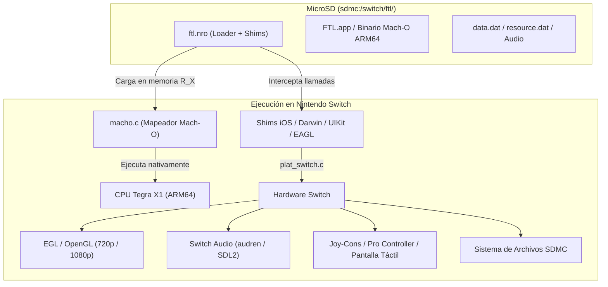

# Plan de Port Nativo de FTL (Faster Than Light) para Nintendo Switch

Este plan detalla la hoja de ruta para crear un port nativo de **FTL: Faster Than Light** para Nintendo Switch en formato Homebrew (`.nro`), listo para copiar en la tarjeta MicroSD y jugar en consolas con Custom Firmware (Atmosphère).

---

## 1. Fundamentos Técnicos del Port

### ¿Cómo funciona un "port nativo" en este caso?
A diferencia de un emulador (como Box64 o emuladores de PC x86), la Nintendo Switch cuenta con un procesador **NVIDIA Tegra X1** con arquitectura **ARM Cortex-A57 de 64 bits (AArch64)**.

La versión para iPad de FTL (`FTL: Faster Than Light 1.6.x`) ya está compilada en código máquina **ARM64 (Mach-O)**. Esto significa que las instrucciones de la CPU del juego se ejecutan **de manera directa en el procesador de la Switch**, sin emulación de instrucciones CPU.



### El papel de `Sidd065/ftl-android`
El repositorio [Sidd065/ftl-android](https://github.com/Sidd065/ftl-android) realizó el trabajo más complejo de ingeniería inversa y emulación de alto nivel (HLE):
1. **Cargador Mach-O (`macho.c`)**: Lee el ejecutable ARM64 de iOS, reubica símbolos y resuelve las dependencias en memoria.
2. **Capa Darwin / libSystem**: Implementa las llamadas POSIX, hilos (`pthread`), mutexes y semáforos de macOS/iOS.
3. **Mini-runtime Objective-C**: Emula `objc_msgSend` y las clases mínimas de iOS necesarias para que el juego arranque.
4. **Shims de UIKit y EAGL**: Intercepta las llamadas gráficas de iOS y las convierte a OpenGL ES estándar.
5. **Capa de Control UX / Mando**: Incluye emulación de cursor para sticks analógicos, aceleración, auto-adherencia a botones, pausa rápida y soporte táctil multitáctil.
6. **Abstracción de plataforma (`platform.h`)**: Separa el motor del juego del sistema operativo host.

Por tanto, para la Switch **no partimos de cero**: creamos un backend de plataforma específico para Switch (`plat_switch.c`) que alimenta esa capa de abstracción.

---

## 2. Aclaración sobre `morluto/rea`

Preguntaste si se debe usar el repositorio [morluto/rea](https://github.com/morluto/rea) (Reverse Engineer Anything):

- **Compatibilidad con Antigravity**: Antigravity soporta servidores MCP exactamente igual que Claude Code. Si se configurara en `mcp_config.json`, las herramientas de REA estarían disponibles.
- **¿Es necesario para este proyecto?**: **No.** 
  - `morluto/rea` está pensado para realizar ingeniería inversa desde cero sobre binarios cerrados o aplicaciones desconocidas (conectándose con Ghidra, Hopper, etc.).
  - En nuestro caso, `ftl-android` **ya realizó esa ingeniería inversa**: ya tiene identificados todos los símbolos, los offsets de memoria, los parches del juego (`patches.c`) y las funciones de interfaz.
  - La tarea actual es de **desarrollo de sistemas e integración homebrew (porting)**, no de desensamblado o descompilación inicial. REA solo sería necesario si quisiéramos investigar alguna versión no documentada o cambiar funciones internas del binario original.

---

## 3. Puntos Críticos y Verificación del Archivo `.ipa`

> [!WARNING]
> ### 1. Versión del Juego (FTL 1.6.21 vs 1.5.10)
> `ftl-android` está diseñado específicamente para **FTL versión 1.6.21** (la última versión de iPad con soporte completo de 64 bits y parches modernos).
> 
> El archivo detectado inicialmente en la carpeta era `FTL__Faster_Than_Light_1.5.10_ios_6.0.ipa`. 
> - Las versiones 1.5.x de la era iOS 6/7 solían ser **ARMv7 de 32 bits**.
> - Nintendo Switch ejecuta ejecutables y código en espacio de usuario en **AArch64 (64 bits puro)**; no admite ejecución de 32 bits.
> - Además, los offsets y parches de `patches.c` en el loader apuntan a las direcciones de la 1.6.21.
> - **Requisito**: Es necesario disponer de una copia de **FTL para iPad v1.6.21**.

> [!IMPORTANT]
> ### 2. Cifrado FairPlay (DRM de Apple)
> Los archivos descargados directamente de la App Store de Apple contienen cifrado DRM FairPlay (`cryptid = 1`). Un cargador de Switch no puede descifrar ese binario en tiempo de ejecución.
> - El binario debe provenir de un **IPA descifrado** (decrypted IPA, volcado con herramientas como Clutch, frida-ios-dump, etc., de un iPad con jailbreak o copias descifradas de preservación).

Hemos dejado preparado un script de diagnóstico en [inspect_ipa.py](file:///C:/Users/ortas/.gemini/antigravity-ide/brain/b112551e-e515-41a3-8694-d93ad0e26672/scratch/inspect_ipa.py) para analizar cualquier archivo `.ipa` y confirmar su arquitectura, versión y estado de cifrado con un solo comando.

---

## 4. Fases de Ejecución del Port

```mermaid
gantt
    title Plan de Desarrollo FTL Switch
    dateFormat  X
    axisFormat  Día %d
    section Fase 1
    Validación de binario IPA y assets     :active, p1, 0, 1
    section Fase 2
    Estructura del repo y CMake Switch    :p2, 1, 2
    section Fase 3
    Implementación plat_switch.c          :p3, 2, 4
    section Fase 4
    Memoria ejecutable y Apple libcxx     :p4, 4, 6
    section Fase 5
    Compilación .nro y pruebas            :p5, 6, 7
    section Fase 6
    Empaquetado final para MicroSD        :p6, 7, 8
```



### Fase 1: Validación y Extracción de Recursos
1. Confirmamos que el archivo IPA contiene el ejecutable `Payload/FTL.app/FTL` en formato ARM64 sin DRM.
2. Extraemos los archivos de datos indispensables:
   - `data.dat` y `resource.dat` (recursos del juego).
   - Directorio de audio y fuentes.
   - Binario ejecutable `FTL`.

### Fase 2: Configuración del Entorno y Sistema de Compilación
1. Creación del repositorio `ftl-switch` adaptando el código fuente de `ftl-android/native`.
2. Preparación del `CMakeLists.txt` con la cadena de herramientas de Switch:
   - Toolchain: `devkitA64` / `libnx`.
   - Generación automática del archivo `.nro` con `elf2nro`.
   - Incorporación de dependencias de Switch: `switch-mesa` (OpenGL/EGL), `switch-sdl2` (o subsistemas nativos `libnx`).

### Fase 3: Capa de Plataforma Switch (`plat_switch.c`)
Implementamos la interfaz requerida por `platform.h`:
- **Gráficos (`plat_gl_*`)**:
  - Creación de contexto EGL sobre la superficie de visualización de libnx (`nwindowGetDefault()`).
  - Detección de modo portátil (1280x720) y modo dock/sobremesa (1920x1080) para escalar la vista.
  - Intercambio de búferes (`eglSwapBuffers`).
- **Control e Input (`plat_pump_events`)**:
  - Lectura de Joy-Cons y mandos Pro mediante `padGetButtonsDown` y `padGetStickPos`.
  - Integración directa con el sistema de cursor inteligente ya escrito en `ux/pad.c` (Stick izquierdo mueve cursor, botón A pulsa, botón X pausa el combate, botones laterales zoom, stick derecho paneo).
  - Mapeo de la pantalla táctil capacitiva de la Switch (`hidGetTouchScreenStates`) al gestor de toques de iOS.
- **Audio**:
  - Salida de audio de baja latencia mediante `SDL2_mixer` o el servicio de audio de libnx (`audren`), conectado al stream PCM/OpenAL de FTL.
- **Sistema de Archivos**:
  - Mapeo de rutas para guardar partidas en `sdmc:/switch/ftl/save/` y cargar recursos desde la misma carpeta.

### Fase 4: Manejo de Memoria y ABI de Apple Libc++
1. **Páginas de Memoria Ejecutables (`R_X`)**:
   - En Nintendo Switch, el homebrew en formato NRO puede mapear memoria con permisos de ejecución gracias a las llamadas de libnx (`svcSetProcessMemoryPermission` / `virtmem`). Adaptamos `macho.c` para que use la asignación de memoria compatible con Horizon OS.
2. **Apple C++ Runtime (`libcxx`)**:
   - Los binarios de iOS utilizan una disposición de memoria específica para `std::string` (`_LIBCPP_ABI_ALTERNATE_STRING_LAYOUT`) y destructores que devuelven el puntero `this` (`-fc++-abi=arm`). Compilamos la librería estática `libcxx.a` con estos flags para el toolchain devkitA64.

### Fase 5: Compilación y Pruebas
1. Compilamos el ejecutable Homebrew `ftl.nro` incluyendo:
   - Icono oficial de FTL (256x256).
   - Nombre de la aplicación y autor.
2. Pruebas de ejecución:
   - Pruebas iniciales en emulador de Switch (Ryujinx o yuzu) para validar el arranque del binario, la carga de texturas y el bucle de eventos.
   - Pruebas en hardware real de Nintendo Switch con Custom Firmware.

### Fase 6: Empaquetado Final para la Tarjeta SD
Estructura final que el usuario copiará en su tarjeta de memoria:

```text
sdmc:/
  └── switch/
        └── ftl/
              ├── ftl.nro               <-- Ejecutable homebrew compilado
              ├── icon.jpg              <-- Icono en hbmenu
              ├── data.dat              <-- Archivos de datos del juego
              ├── resource.dat          <-- Gráficos y sonido
              ├── FTL                   <-- Binario Mach-O descifrado de iPad
              └── save/                 <-- Partidas guardadas automáticas
```

---

## 5. Próximos Pasos Recomendados

1. **Confirmar el archivo IPA**:
   - Verificar si dispones de la versión **1.6.21** de FTL para iPad descifrada.
   - Ejecutar el script de verificación sobre tu archivo para comprobar arquitectura y DRM.
2. **Decidir el método de compilación**:
   - **Opción A (Recomendada)**: Configurar un flujo de **GitHub Actions** en el repositorio. Permite compilar el `.nro` automáticamente en los servidores de GitHub con devkitPro sin tener que instalar cientos de megabytes de herramientas en Windows.
   - **Opción B**: Instalar la cadena de herramientas local (`devkitPro` con `devkitA64` y `libnx`) en tu equipo o en WSL.
